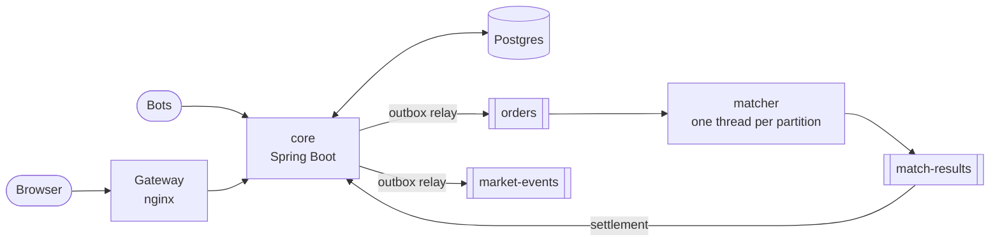

# Game Item Exchange

An exchange for in-game items with an order-book matching engine. Games put items into players' inventories
through an API, players trade them for credits, and every trade settles through a double-entry ledger.

It is a portfolio project: the credits are play money, bots trade around the clock so the market is always
moving, and anyone can try it with a guest account.

## The path of an order



1. **core accepts the order.** One Postgres transaction validates it, reserves the buyer's credits or the
   seller's items, and writes the order together with an outbox row. Either all of it happens or none of it.
2. **The relay publishes it.** Outbox rows go to the `orders` topic in commit order. Topics are partitioned
   by market, so the orders of one market are always seen in the order they were accepted.
3. **The matcher matches it.** Each partition belongs to a single thread that holds its order books in memory:
   price-time priority, GTC, IOC and FOK, no locks on the hot path. The matcher has no database. After a restart
   it rebuilds its books by replaying `orders` and publishes only what it had not published before.
4. **core settles the results exactly once.** Each result is applied in one transaction that records its id,
   so a repeated delivery changes nothing. Credits move through a double-entry ledger, items between
   inventories. Settlement also updates the one-minute candles and the public market events in the same
   transaction.

More on the design:

- **Failures stop, they are not smoothed over.** If a match result disagrees with core's state, settlement
  retries it forever instead of skipping it. The partition stalls, which shows up as consumer lag, and resumes
  once the cause is fixed. Moving money on top of an inconsistency only makes it worse.
- **Retries are safe end to end.** Orders carry a client order id: sending the same order twice returns the
  first one. The relay delivers at least once, and every consumer deduplicates.
- **Where the money is.** Every credit in the system came from the `GRANTS` account, whose negative balance
  is the total ever issued. Fees collect in `FEES`. The sum over all accounts is always zero.

## Repository

| | |
|---|---|
| [`platform/core`](platform/core) | Kotlin, Spring Boot 4: HTTP API, order acceptance, settlement, ledger, outbox relay |
| [`platform/matcher`](platform/matcher) | Kotlin with plain Kafka clients: the matching engine |
| [`platform/contracts`](platform/contracts) | Kafka message formats shared by both |
| [`platform/web`](platform/web) | React and TypeScript; the nginx image that serves it is also the gateway |
| [`clients/bots`](clients/bots) | Market makers and takers in TypeScript, an ordinary API client |
| [`deploy`](deploy) | Kubernetes: manifests, Strimzi Kafka, Prometheus and Grafana with a dashboard |
| [`deployment`](deployment) | Production: Docker Compose on a VDS, deployed by GitHub Actions |
| [`docs/api.md`](docs/api.md) | The HTTP API |

## Running it locally

### In Kubernetes

Needs Docker, [k3d](https://k3d.io), kubectl, Helm and JDK 25.

```sh
scripts/cluster-up.sh   # cluster, Prometheus and Grafana, Strimzi, Kafka, then the platform
scripts/deploy.sh       # after every code change: build images, load them into the cluster, roll out
```

The site is at http://localhost:8081/exchange/. Grafana:

```sh
kubectl -n monitoring port-forward svc/monitoring-grafana 3000:80   # admin / admin-local-only
```

The local cluster runs two core replicas with a separate relay, two matchers that split the partitions,
and the bots.

### From the IDE

```sh
docker compose -f docker-compose.dev.yml up -d   # Postgres and Kafka with the topics
```

Then run core with the `dev` profile and `MatcherAppKt`, and the web app with `npm run dev` in
`platform/web`. The `dev` profile adds two users with balances (Alice and Bob) and accepts an
`X-Dev-User-Id` header instead of a token.

## Production

The public instance runs the same images in Docker Compose on a small server shared with other projects:
one process of each kind and a single Kafka broker. Every push to `main` is built, tested and deployed by
GitHub Actions. See [deployment/README.md](deployment/README.md).
